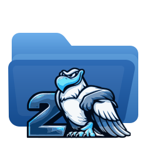
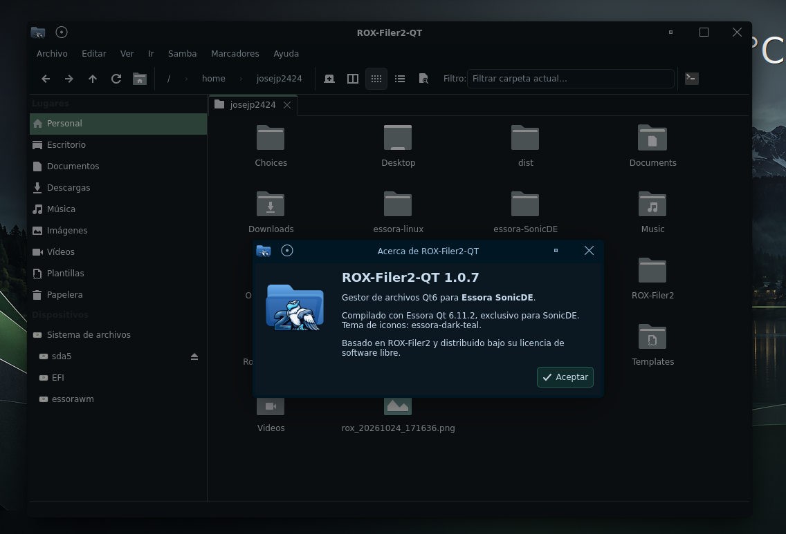

# Rox-Filer2-QT 1.0.7

<p align="center">
  
</p>

<p align="center">
  
</p>

<p align="center">
  <strong>A modern Qt6 file manager built on the ROX-Filer philosophy.</strong>
</p>

**Rox-Filer2-QT** is an independent, Qt6-based edition of Rox-Filer2 developed as part of the **Essora Project**. It brings the speed and direct file-management workflow of ROX to a modern interface, with tabs, split views, a Places sidebar, file previews, device management and configurable desktop drive icons.

It is designed for **Essora, SonicDE, KDE Plasma** and other Linux desktops. It can be compiled using the distribution's Qt6 development packages; Essora's custom Qt installation is **not required**.

This is a **Qt6-only application with one modern interface**. It is not a GTK-to-Qt theme conversion, and it does not replace an existing ROX-Filer GTK installation.

## Highlights

### Modern file browsing

- Tabbed browsing and **split view (`F3`)** for working with two locations side by side.
- Places sidebar for convenient access to folders, devices and mounted images.
- Path navigation, file search and **quick filtering (`Ctrl+I`)**.
- Icon and detailed file views, image thumbnails and an optional preview pane.
- Drag-and-drop operations, context menus, MIME-aware opening and application selection.
- Copy, move, rename, delete, create links and folders, and advanced file selection.

### File transfers you can follow

Copy and move operations have a dedicated progress interface with transferred data, progress and estimated time remaining. For copied data, Rox-Filer2-QT also performs destination filesystem synchronization before reporting the operation complete, rather than closing the progress window while buffered writes are still pending.

### Drives, disk images and network shares

- Mount and unmount removable drives using **UDisks2 and D-Bus**, with Polkit authorization when needed.
- Open and manage **ISO, SFS, SquashFS and IMG** images, including supported partitions in raw disk images.
- Show ROX-managed mounted images in Places and, when enabled, among desktop drive icons.
- Connect to **SMB/CIFS** shares and work with Samba user shares when the required system utilities are available.
- No mandatory GVfs dependency for the main file-management and mounting workflows.

### Desktop integration for SonicDE and KDE

Rox-Filer2-QT includes a separate desktop drive-icon companion for **X11/XLibre** sessions. It can display disks and mounted images on the desktop **without taking control of the wallpaper or replacing the desktop layer** managed by SonicDE or KDE Plasma.

Drive icons can be enabled or hidden and configured through the application's preferences, including their position and arrangement. The regular file manager works independently of desktop drive icons.

### Administrative access and appearance

A dedicated **`roxfiler-qt-root`** launcher opens an administrative file-manager window using the configured authorization mechanism. It carries over a validated snapshot of the user's Qt palette, font, style and icon theme, while keeping root's own permissions and configuration separate.

### Languages

English is the default interface language. Eleven additional Qt translation catalogs are included: **Arabic, Catalan, German, Spanish, French, Hungarian, Italian, Japanese, Portuguese, Russian and Chinese**. Untranslated strings fall back to English.

## Supported platforms and requirements

Rox-Filer2-QT targets Linux systems with **Qt 6.4 or newer**, a C++20 compiler, CMake 3.22 or newer, Qt Widgets, Qt D-Bus and Qt translation tools (`lrelease`). Qt SVG is recommended for improved SVG rendering.

Build helpers are included for **Debian, Devuan, Essora, Void Linux and Arch Linux**. Other distributions can build the project when the required Qt6 development SDK and supporting tools are available. Neither systemd nor GTK3 is a compile-time requirement.

The application is written for Qt6; **Qt5 is not supported**.

## Build from source

Clone or download the source, then run these commands from the project directory. **Compilation does not require root privileges.**

### Debian, Devuan, Essora and other supported distributions

```bash
./dependencies.sh --check
JOBS=4 ./build.sh
./build-qt/rox-filer2-qt "$HOME"
```

### Void Linux

The Void build script selects the **system Qt6 SDK** and does not build a Debian package:

```bash
./dependencies.sh --check
JOBS=4 ./build-void.sh
./build-qt/rox-filer2-qt "$HOME"
```

If development packages or runtime tools are missing, run one of the following **as root**, then return to your regular user account to compile:

```bash
./dependencies.sh --install-build   # Compiler, Qt6 and development libraries
./dependencies.sh --install-full    # Also install available runtime/device tools
```

The dependency installer uses the package names appropriate for APT, XBPS or pacman. It includes optional development libraries and tools for **libmtp, libgphoto2, libimobiledevice, Samba/libsmbclient, FUSE 2/3** and related devices. See [Dependency details](docs/DEPENDENCIES.md).

### Select your Qt6 installation

`build.sh` automatically detects a suitable SDK. On Essora it can use `/opt/essora/qt6`; on Void the system SDK is selected by default. You can override the selection:

```bash
QT_MODE=system JOBS=4 ./build.sh           # Distribution Qt6
QT_MODE=essora JOBS=4 ./build.sh           # /opt/essora/qt6
QT_PREFIX=/path/to/qt6 JOBS=4 ./build.sh  # Custom Qt6 prefix
```

On Debian-family systems, `build.sh` also creates a `.deb` in `output/` when packaging tools are available. To compile without generating a package:

```bash
PACKAGE_DEB=0 ./build.sh
```

A package built against Essora's Qt in `/opt` needs a compatible Essora Qt runtime on the destination computer. **Use `QT_MODE=system` when building for the distribution's own Qt6 packages.**

## Installation and usage

Install the compiled application through its generated distribution package where possible. Alternatively, as root:

```bash
cmake --install build-qt
```

Useful commands after installation:

```bash
rox-filer2-qt "$HOME"       # Open the file manager
rox-filer2-qt --desktop     # Start desktop drive icons (X11/XLibre)
rox-filer2-qt --list-images # List detected mounted images
roxfiler-qt-root            # Open an administrative window
```

The installation also provides `rox-qt` and `rox-qt-drives`. It does **not** overwrite an existing `/usr/bin/rox` command by default, so the GTK version and this Qt edition can coexist.

## Current scope

Rox-Filer2-QT is a usable, separately developed Qt frontend, not a promise of exact GTK3 feature parity:

- **Android MTP, camera PTP and Apple/iOS integration** are not yet fully implemented in the Qt interface. Installing their optional libraries does not automatically enable those workflows.
- **Desktop drive icons** require X11/XLibre or a compatible X11 environment. The regular Qt browser may run on Wayland, but no native Wayland desktop-icon layer is provided.
- The desktop companion is intended for **drive icons**, not the full ROX GTK pinboard (`PuppyPin`) or arbitrary desktop shortcuts.
- Available thumbnails and previews depend on Qt image formats and installed runtime helpers.

For important files, test copy, move and delete operations with disposable data before putting a new build into daily use.

## Development and testing

```bash
./validate-source.sh
WITH_TESTS=1 PACKAGE_DEB=0 ./build.sh
```

The Qt regression suite covers file operations, transfer progress, drag and drop, application opening, selections, extended attributes and UI interactions. Build tests run through CTest.

See [README en español](README-ES.md), [dependency documentation](docs/DEPENDENCIES.md) and [CHANGELOG.md](CHANGELOG.md) for further information.

## Project and credits

Rox-Filer2-QT is developed as part of the **Essora Project** and builds on the work of the original **ROX-Filer / Rox-Filer2** authors and subsequent contributors. Their authorship, copyright notices and applicable licensing are retained. See [LICENSE](LICENSE) and the source headers.

This project is an independent Qt edition; it is **not an official SonicDE release** or a replacement for the GTK3 Rox-Filer2 codebase.
